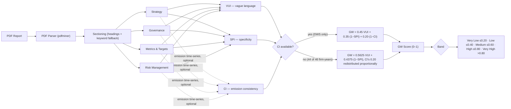
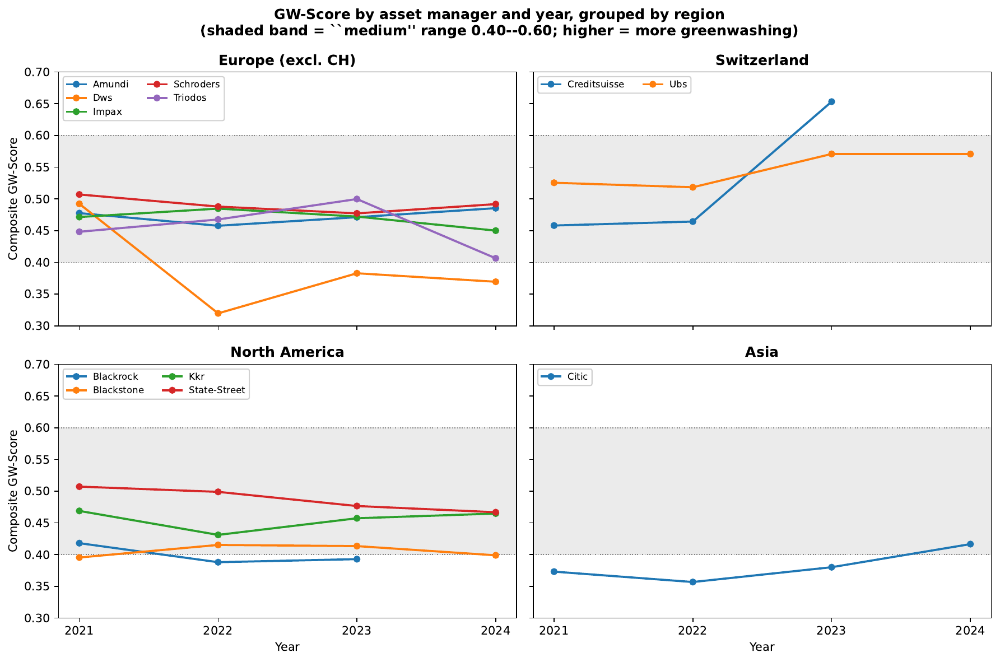
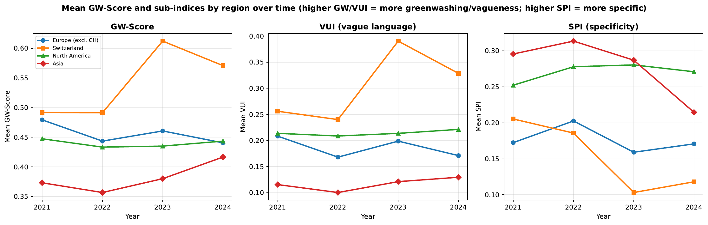
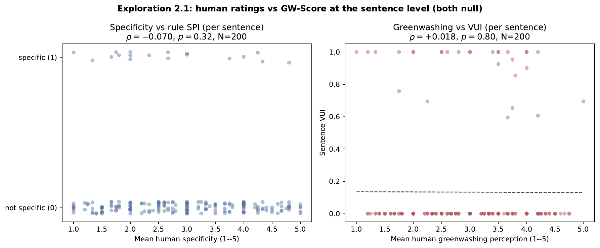
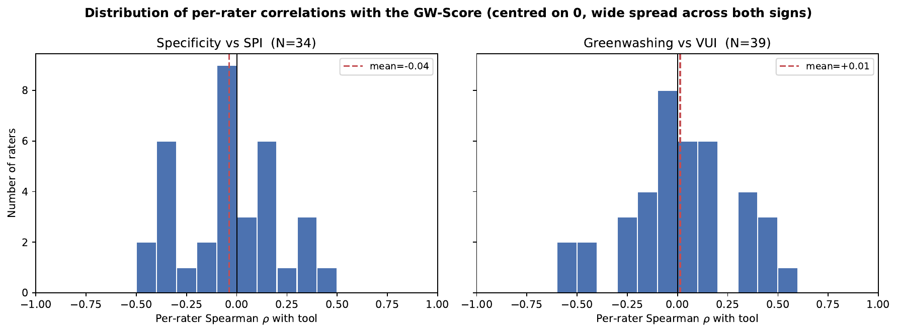

# Greenwashing Detection Pipeline

[](LICENSE)
[](requirements.txt)
[](tests/)
[](#source-reports)

**Can an algorithm tell when a sustainability report is all talk?** This repository is an end-to-end, fully transparent attempt to answer that, and an honest test of whether the answer holds up against human judgement.

It combines two things that are rarely found together:

1. **Part A: a deterministic, explainable NLP pipeline.** It reads ESG and sustainability PDF reports, splits them into TCFD sections and scores each report on three dimensions: vague language (VUI), specificity (SPI) and emission consistency (CI). These are combined into a single greenwashing score (GW, 0–1). Every score traces back to concrete sentences, regex hits and config values.
2. **Part B: a human validation study.** 42 finance-literate participants rated 200 real sentences from the same reports plus 20 gold-standard anchors on specificity and perceived greenwashing.

**The headline is a null result, reported in full.** The rule-based scores fire exactly as designed on the gold anchors (mean SPI 0.90 for specific vs. 0.00 for vague anchors), but on authentic corporate prose they do **not** correlate with how readers judged the same sentences (all |ρ| ≤ 0.07, none significant). Even the human raters agree only weakly with one another (α = 0.31). The [Human Validation Study](#human-validation-study-part-b) section explains why this happens, which rule patterns break, and what a better design would look like.

### At a glance

| | |
|---|---|
| **Corpus** | 46 annual / sustainability reports, 12 global asset managers (BlackRock, UBS, Amundi, KKR, …), 2021–2024 |
| **Method** | Rule-based scoring (regex + spaCy), optional zero-shot NLI (`bart-large-mnli`), fully driven by [`config.yml`](config.yml) |
| **Validation** | 42 raters, 840 ratings, 220 sentences, Krippendorff's α, Spearman ρ, counterbalanced presentation orders |
| **Reproducibility** | One command per report or for the whole batch; all 46 results included in `outputs/` |
| **Key insight** | Lexical rules capture *form* (numbers, hedge words); human readers judge *substance*. The gap is measurable and documented. |

---

## Pipeline



CI is only computed for firms with a disclosed year-on-year Scope 1+2 emissions series; in this corpus that's DWS (2023–2024) alone. Everywhere else the composite falls back to VUI and SPI, with CI's weight folded into them proportionally rather than left unassigned — see [`src/gw.py`](src/gw.py) and [`config.yml`](config.yml).

---

## Scoring Components

| Component | What it measures | Weight | Direction |
|-----------|-------------------|--------|-----------|
| **VUI** — Vague/Uncertain Language Index | Hedge words and epistemic-uncertainty markers per 1,000 words of relevant text | 0.45 | Higher VUI → higher GW |
| **SPI** — Specificity Index | Fraction of sentences with a concrete, measurable claim (number + unit + forward-looking target/baseline) | 0.35 | Higher SPI → lower GW |
| **CI** — Consistency Index | Year-on-year Scope 1+2 emission-reduction consistency | 0.20 | Reductions → lower GW |

**SPI modes:**
- `--rule-only` — deterministic regex/structural gate (fast, no model download; used for every number in this README and in the thesis)
- `--enable-nli` — blends the rule (60%) with a zero-shot NLI entailment check (`facebook/bart-large-mnli`, τ = 0.8, 40%). Computed for all 46 documents (`outputs/batch_nli/`) but kept out of the headline scores so the divergence analysis below can speak about the deterministic rules alone.

---

## GW Band Scale

| Band | GW Score | Survey equivalent | Interpretation |
|------|----------|--------------------|-----------------|
| Very Low | ≤ 0.20 | 1 — Not at all | Highly specific, consistent, low hedging |
| Low | ≤ 0.40 | 2 — Slightly | Mostly specific with minor vagueness |
| Medium | ≤ 0.60 | 3 — Moderately | Mixed signals — some commitments, some vague language |
| High | ≤ 0.80 | 4 — Very | High vagueness or low specificity |
| Very High | > 0.80 | 5 — Extremely | Pervasive hedging, no measurable commitments |

---

## Quickstart

Tested with Python 3.13. The source PDFs are not included in the repository (see [Source Reports](#source-reports)); place them in `inputs/` first.

**Setup:**
```bash
python -m venv .venv && source .venv/bin/activate
pip install -r requirements.txt        # or requirements-dev.txt for pytest + jupyterlab
python -m spacy download en_core_web_sm
```

**Tests:**
```bash
pip install -r requirements-dev.txt
pytest tests/
```

**Single PDF:**
```bash
# Rule-only (fast)
python -m src.pilot --pdf inputs/dws-2024.pdf --year 2024 --outdir outputs/

# With emission time-series for CI scoring
python -m src.pilot --pdf inputs/dws-2024.pdf --year 2024 \
  --ci-values "2022:2694,2023:2126,2024:1497" --outdir outputs/

# NLI-enhanced (requires torch + transformers)
python -m src.pilot --pdf inputs/dws-2024.pdf --year 2024 --enable-nli \
  --ci-values "2022:2694,2023:2126,2024:1497" --outdir outputs/
```

**Batch run (all 46 PDFs, rule-only):**
```bash
python scripts/run_batch.py
```
Writes `outputs/batch/<company>/run_<year>.json` for every PDF in `inputs/`. This is the script the thesis (Section 3, "Replication") cites for reproducing every GW-Score in the appendix; it is a standalone extraction of the same logic in `scripts/run_all.ipynb` Cell 1. For the NLI-enhanced pass, or for the plots below, use the notebook directly:
```bash
jupyter lab scripts/run_all.ipynb
```

---

## Batch Results — Rule-Only (46 reports, 12 companies, 2021–2024)




| Company | 2021 | 2022 | 2023 | 2024 | Avg Band |
|---------|------|------|------|------|----------|
| Amundi | 0.478 | 0.458 | 0.471 | 0.485 | medium |
| BlackRock | 0.418 | 0.388 | 0.393 | — | low–medium |
| Blackstone | 0.396 | 0.415 | 0.413 | 0.399 | medium |
| CITIC | 0.373 | 0.357 | 0.380 | 0.417 | low–medium |
| Credit Suisse | 0.458 | 0.464 | **0.653** | — | medium–high |
| DWS | 0.492 | 0.320 | 0.383 | 0.369 | low–medium |
| Impax | 0.472 | 0.485 | 0.472 | 0.450 | medium |
| KKR | 0.469 | 0.431 | 0.457 | 0.465 | medium |
| Schroders | 0.507 | 0.488 | 0.477 | 0.492 | medium |
| State Street | 0.507 | 0.499 | 0.477 | 0.467 | medium |
| Triodos | 0.448 | 0.468 | 0.500 | 0.406 | medium |
| UBS | 0.526 | 0.518 | 0.571 | 0.571 | medium |

> Credit Suisse 2023 (GW = 0.653, *high*) is the year of its forced UBS acquisition — a very low SPI (0.10) and elevated VUI (0.46) drive the score. This and the DWS 2022 trough are consistent with external events (the CS acquisition, DWS's greenwashing allegations that year) but are reported as plausibility checks, not causal claims — see the thesis Discussion §5.1 for the full reasoning. Missing cells are documents not available at the data-collection cutoff (Credit Suisse 2024, BlackRock 2024).

---

## Human Validation Study (Part B)

Whether the pipeline's VUI and SPI scores track how a trained reader judges the same text — tested against 42 domain-knowledgeable Prolific participants rating 200 real sentences and 20 gold-standard anchors drawn from the 46 batch reports.

**Design:** Prolific + SoSci Survey, 5-point Likert ratings on specificity and greenwashing perception. Each participant rated 20 sentences drawn from a 220-item pool via an urn-draw allocation (keeps ratings-per-sentence roughly equal), counterbalanced across 5 presentation orders.

**Sample:** 50 submissions → 44 approved by Prolific → 42 retained after a 180-second speed-based QC filter (840 ratings, 761 on real sentences, 79 on gold anchors; 220/220 sentences covered, median 4 raters per sentence).

### Key Findings

| Metric | Result | Interpretation |
|---|---|---|
| Krippendorff α — Specificity | **0.450** (post-QC, n=42); 0.462 pre-QC (n=44) | "Fair" agreement |
| Krippendorff α — Greenwashing perception | **0.306** (post-QC); 0.310 pre-QC | "Slight" agreement — below the 0.67 threshold for a reliable ground truth |
| Spearman ρ — Specificity ↔ SPI, **sentence level** (same granularity the raters judged at) | **−0.070** (p = 0.32, N = 200) | No correlation |
| Spearman ρ — GW perception ↔ VUI, **sentence level** | **+0.018** (p = 0.80, N = 200) | No correlation |
| Spearman ρ — original firm-year comparison (each sentence paired with its report's score) | all &#124;ρ&#124; < 0.03, all p > 0.73 | Also null — rules out granularity mismatch as the *sole* explanation |
| SFDR sub-sample — Mann–Whitney U, focused vs. mixed managers on SPI | **U = 54, p = 0.68** (5 firms, 20 firm-years) | No discrimination; exploratory, underpowered |
| Counterbalance — Kruskal–Wallis across 5 presentation orders | H = 0.99, p = 0.91 (GW); H = 5.26, p = 0.26 (specificity) | No order effect |
| Sentence-position / fatigue effect | ρ = −0.015, p = 0.68 | None detected |

> **Robustness:** re-running every correlation on the full N = 44 pre-QC pool (i.e. without excluding the 2 speed-flagged participants) shifts every Spearman ρ by < 0.014 and Krippendorff's α by < 0.012 — the null is not an artefact of that exclusion (see [survey_analysis.ipynb](scripts/survey_analysis.ipynb) §6d).




### Interpretation

Two comparisons are reported, and both return a null: pairing each sentence with the firm-year score it inherited (the original design, in which up to 46 sentences share one GW-Score value) returns |ρ| < 0.03 for both dimensions; re-scoring every sentence individually — so both sides operate at the same granularity the annotators actually judged at — still returns ρ ≈ 0 (−0.070 / +0.018, N = 200). The granularity mismatch between sentence-level ratings and firm-year scores was the most plausible benign explanation for the first null. Testing it directly does not recover a correlation, so it is a real but secondary obstacle, not the cause.

A qualitative look at the sentences where the pipeline and the raters disagree most identifies four recurring, rule-traceable patterns (full detail in [survey_analysis.ipynb](scripts/survey_analysis.ipynb) and the thesis §5.2.1):
- **SPI misses nominal/institutional specificity** — named people, governance bodies, concrete roles carry no numeric target and are scored as vague.
- **SPI over-counts numeric boilerplate** unrelated to any sustainability claim (e.g. AGM appointment procedure, board-review cadence).
- **VUI misses rhetorical vagueness** that doesn't use one of the listed hedge words (e.g. platitudes about "diversity policy approach").
- **VUI penalises hedges next to a genuinely concrete target** — "approximately 30% by 2025" is marked vague for the word "approximately" despite the numeric target.

Inter-rater reliability is part of the story too: agreement on greenwashing perception (α = 0.31) itself falls short of the 0.67 threshold conventionally required to treat aggregated human ratings as a reliable ground truth. That means the null cannot be attributed to the pipeline alone — the human criterion is also noisy, and both may be affected by validity and reliability problems. Both diagnoses point the same way: **in its current form the pipeline does not track expert perception at the sentence level**, and the indicated fix is a sentence-level re-architecture of VUI/SPI (see Future Work in the thesis) rather than abandoning the approach — the rule fires cleanly on the synthetic gold anchors (mean SPI 0.90 specific vs. 0.00 vague), so the deterministic logic works as designed; it just doesn't yet capture what these readers treat as specific or vague in authentic corporate prose.

### Reproducing

```bash
jupyter lab scripts/survey_analysis.ipynb
```

**Inputs:** `data/sosci_export.csv`, `data/prolific_demographics.csv`, `archive_survey_drafts/prolific_survey_key.csv` (participant data, not included in this repository), plus `outputs/batch/*/run_*.json` from the batch run above.

> **Note:** Part B cannot be re-run from this repository alone, because the participant-level survey data is not published (see [Data Availability](#data-availability)). The item pool, sentence-level pipeline scores and all aggregate results are included.

---

## File Structure

```
gw-pilot-v1/
├── src/
│   ├── pilot.py          # Main pipeline orchestrator (CLI entry point)
│   ├── parsing.py        # PDF text extraction (pdfminer) + sentence splitting
│   ├── sectioning.py     # Page → TCFD section assignment
│   ├── vui.py            # Vague language scoring
│   ├── spi.py            # Specificity scoring (rule-based)
│   ├── nli.py            # NLI semantic scoring (BART-MNLI)
│   ├── ci.py             # Emission consistency index
│   ├── gw.py             # GW score aggregation + banding
│   └── text_utils.py     # Shared utilities (normalize_year_tokens)
├── inputs/               # PDF reports (not tracked)
├── outputs/
│   ├── batch/             # Rule-only batch results (JSON per company/year)
│   ├── batch_nli/          # NLI-enhanced batch results
│   └── figures/             # Exported thesis figures (PDF)
├── scripts/
│   ├── run_batch.py             # Standalone batch-scoring CLI (extracted from run_all.ipynb Cell 1)
│   ├── run_all.ipynb            # Batch runner + visualisation (Part A)
│   └── survey_analysis.ipynb    # Human validation study (Part B)
├── data/
│   ├── sosci_export.csv         # SoSci Survey responses (UTF-16, not published)
│   └── prolific_demographics.csv  # (not published)
├── archive_survey_drafts/     # Survey construction artefacts (item pool, review files)
├── tests/                 # pytest suite (pipeline regression tests)
├── config.yml             # All thresholds, patterns, weights
├── requirements.txt
├── requirements-dev.txt   # + pytest, jupyterlab
├── CITATION.cff
└── LICENSE
```

---

## Config Reference

| Parameter | Default | Description |
|-----------|---------|--------------|
| `weights.vui` | 0.45 | VUI weight in the GW formula |
| `weights.r_spi` | 0.35 | SPI weight (applied as 1 − SPI) |
| `weights.r_ci` | 0.20 | CI weight (applied as 1 − CI; redistributed proportionally when CI is unavailable) |
| `nli.model` | `facebook/bart-large-mnli` | Zero-shot entailment model for the hybrid SPI |
| `nli.tau` | 0.80 | Entailment threshold for the NLI gate |
| `sectioning.min_density` | 0.02 | Min keyword density for fallback sectioning |
| `sectioning.min_words_per_section` | 100 | Min words to include a section |
| `spi.unit_patterns` | `%, tCO2e, kt, mt, ...` | Units that count toward numeric specificity |

---

## Ideas & Extensions

The pipeline is deliberately simple and modular: each index is a small, self-contained module in `src/`, and every threshold lives in `config.yml`. That makes it a good starting point for further work. Some directions that follow directly from the findings:

**Improve the method**
- **Sentence-level re-architecture.** Score every sentence first and aggregate afterwards, so that pipeline and human judgement operate on the same unit (the main recommendation from Part B).
- **Learn from the human ratings.** Use the 840 ratings and the gold anchors as a small training / calibration set for a fine-tuned classifier (e.g. a ClimateBERT- or DeBERTa-based specificity model), and compare it to the rules.
- **Fix the four documented failure patterns.** Recognise named bodies and roles as specific, filter numeric boilerplate, detect rhetorical vagueness without hedge words, and stop penalising hedges next to a concrete target.
- **LLM-as-annotator.** Have an LLM rate the same 220 sentences and measure whether it agrees with human raters better than the rules do, and better than raters agree with each other.
- **More CI coverage.** Extract Scope 1–3 emission tables automatically from the PDFs, so the consistency index works for every firm instead of one.

**Apply it elsewhere**
- **Other sectors.** Banks, insurers, energy and consumer goods companies publish the same kind of reports; only the keyword lists and section patterns need adjusting.
- **Regulatory disclosures.** SFDR pre-contractual documents, EU Taxonomy reports, CSRD / ESRS sustainability statements or fund prospectuses.
- **Monitoring over time.** Run the batch every reporting season and track how a firm's language changes, for example after a regulatory event or a greenwashing allegation.
- **Screening tool for analysts.** Use the per-sentence hits as a reading aid: highlight the most vague and the most specific passages of a 200-page report in seconds.
- **Teaching material.** A compact, real-world example of how to build, validate and honestly report an NLP measurement instrument, including inter-rater reliability and a null result.

Contributions, forks and follow-up studies are welcome. If you build on this work, please cite it (see [`CITATION.cff`](CITATION.cff)).

---

## Source Reports

The 46 input documents are publicly available sustainability / ESG / annual reports, downloaded from each firm's investor-relations or sustainability website. They are not redistributed here. To reproduce the batch results, save them to `inputs/` using the naming scheme `<company>-<year>.pdf`:

| Company | Years | Filenames |
|---------|-------|-----------|
| Amundi | 2021–2024 | `amundi-2021.pdf` … `amundi-2024.pdf` |
| BlackRock | 2021–2023 | `blackrock-2021.pdf` … `blackrock-2023.pdf` |
| Blackstone | 2021–2024 | `blackstone-2021.pdf` … `blackstone-2024.pdf` |
| CITIC | 2021–2024 | `citic-2021.pdf` … `citic-2024.pdf` |
| Credit Suisse | 2021–2023 | `creditsuisse-2021.pdf` … `creditsuisse-2023.pdf` |
| DWS | 2021–2024 | `dws-2021.pdf` … `dws-2024.pdf` |
| Impax | 2021–2024 | `impax-2021.pdf` … `impax-2024.pdf` |
| KKR | 2021–2024 | `KKR-2021.pdf` … `KKR-2024.pdf` |
| Schroders | 2021–2024 | `schroders-2021.pdf` … `schroders-2024.pdf` |
| State Street | 2021–2024 | `state-street-2021.pdf` … `state-street-2024.pdf` |
| Triodos | 2021–2024 | `triodos-2021.pdf` … `triodos-2024.pdf` |
| UBS | 2021–2024 | `UBS-2021.pdf` … `UBS-2024.pdf` |

The precomputed results for all 46 documents are included in `outputs/batch/` and `outputs/batch_nli/`, so the figures and tables can be inspected without the PDFs.

---

## Data Availability

Participant-level survey data (`data/sosci_export.csv`, `data/prolific_demographics.csv`, `archive_survey_drafts/prolific_survey_key.csv`) is not published, for privacy/GDPR reasons. A de-identified export is available on reasonable request for academic verification. The survey item pool and construction artefacts are in `archive_survey_drafts/`.

---

## Authors & License

- Part A (pipeline): Florian Eisinger
- Part B (human validation study): Maxim Gómez Valverde

Released under the [Creative Commons Attribution-NonCommercial 4.0 International License (CC BY-NC 4.0)](LICENSE). You may share and adapt this work for non-commercial purposes, with attribution to the authors. For commercial use, please contact the authors.
