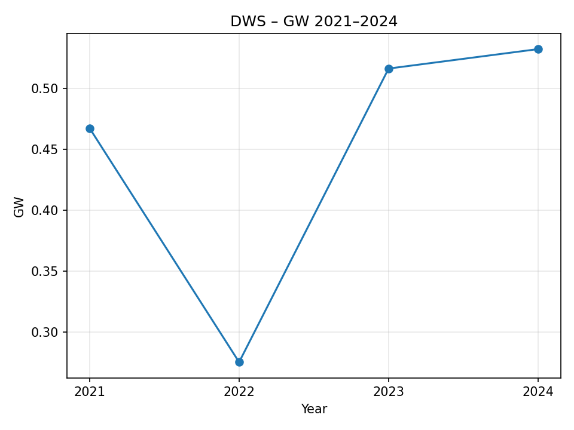
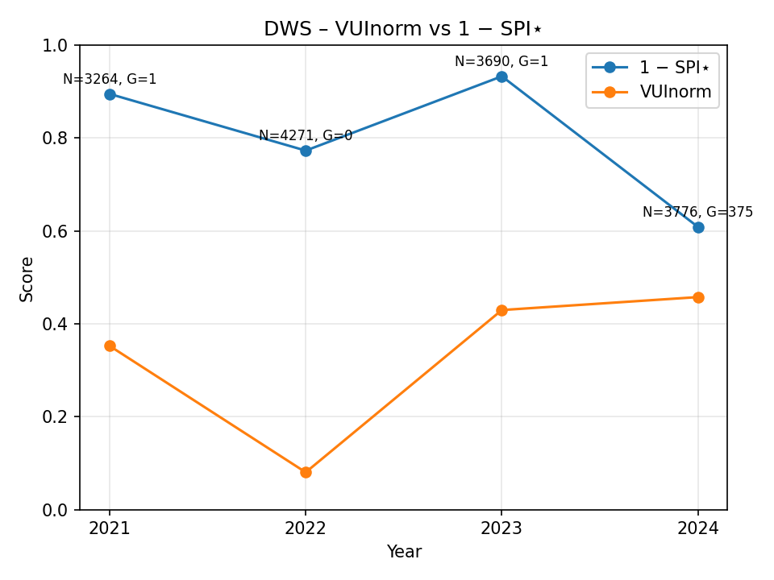

# GW Pilot (v0.2-mini)

Reproducible snapshot of our greenwashing detection pilot:
- Rule-based VUI (vague term density) and SPI (specificity) signals
- AI-enhanced specificity via RoBERTa large MNLI with gating and tau=0.5
- Hybrid SPI* (rule + AI) feeds Greenwashing (GW) score
- Reproducible runs with config+manifest; curated charts in docs/img

## 1) What problem we solve
Sustainability reports often contain vague language and unverified targets. We provide:
- A transparent, repeatable scoring method across reports and years
- A split of "vagueness" vs. "specificity" rather than a black-box single score
- Human-auditable outputs (JSON runs, charts, and a manifest with versions)

## 2) Method overview (plain English)
1. Parse report sections (Strategy, Governance, Metrics & Targets, optionally Risk).
2. Compute VUI: vague term hits per 1,000 words, normalized to [0,1].
3. Compute SPI_rule: fraction of sentences that match handcrafted specificity rules.
4. Gate sentences likely to contain hard facts (numbers, dates, targets, scopes); run NLI.
   - Model: roberta-large-mnli (CPU), tau=0.5 entailment threshold.
   - AI specificity rate = share of gated sentences entailed as "specific".
5. Blend rule and AI into SPI* (hybrid specificity). More specific -> higher SPI*.
6. GW score combines normalized VUI (higher = more vague) and (1 - SPI*).
   - Current weights (from config): w_v = 0.5625, w_s = 0.4375, w_c = 0.0 (CI off).

## 3) Formula (as implemented)
- VUI_1000 = vague_term_hits / total_words * 1000  (then normalized to [0,1])
- SPI_rule = specific_sentences / total_sentences
- SPI* = blend(SPI_rule, AI_specificity_rate)  // details in code, config.yml
- GW = w_v * VUI_norm + w_s * (1 - SPI*)        // w_c * CI omitted, CI not used

Notes:
- CI (coverage/confidence) is not implemented in this release and weight is 0.0.
- If AI is disabled or gate yields 0 sentences, SPI* falls back to SPI_rule.

## 4) Reproducibility
We lock versions and record a manifest.
- Requirements: see requirements.txt
- Config: config.yml (profiles.loose.nli: tau=0.5 and a permissive gate)
- Run manifest: outputs/run_manifest.json stores commit, config SHA1, versions

Quick reproduce (DWS 2024):
```powershell
python -m venv .venv; .\.venv\Scripts\Activate.ps1
pip install -r requirements.txt
$env:PYTHONPATH=(Get-Location).Path
python -m src.pilot --config config.yml --issuer dws --year 2024 --pdf data\raw\dws-2024.pdf --enable-nli --profile loose
python scripts\build_summary.py
python scripts\plot_series.py
```

## 5) Current results (selected)
We publish curated CSVs and PNGs:

Artifacts:
- outputs/canonical_runs.csv
- outputs/summary_latest.csv
- outputs/summary_runs_full.csv
- outputs/run_manifest.json
- docs/img/gw_series_dws.png
- docs/img/vui_vs_1minus_spistar_dws.png
- docs/img/gw_cross_section_latest_bar.png   (only appears if >= 3 issuers included)

Example (DWS 2021–2024, hybrid on):
| Year | VUI_norm | SPI_rule | SPI* (hybrid) | GW    |
|-----:|---------:|---------:|--------------:|------:|
| 2021 | 0.3515   | 0.0799   | 0.3835        | 0.4674|
| 2022 | 0.0778   | 0.2045   | 0.4709        | 0.2753|
| 2023 | 0.4468   | 0.0880   | 0.3940        | 0.5164|
| 2024 | 0.4575   | 0.0747   | 0.3712        | 0.5324|

Interpretation:
- Higher VUI_norm means more vague wording.
- Higher SPI* means more specific content (so 1 - SPI* becomes smaller).
- GW rises with vagueness and falls with specificity.

## 6) How to regenerate charts
We provide small utilities; outputs must exist first (see reproduce step).
```powershell
python scripts\build_summary.py
python scripts\plot_series.py
```
Charts end up in docs/img.

## 7) Limitations and scope
- AI model is a general NLI model; it is not fine-tuned on ESG. We gate to reduce off-topic inferences.
- We do not verify factual truth (only specificity/entailment of claims).
- Cross-issuer comparisons depend on sectioning quality; PDFs with poor structure may degrade metrics.

## 8) Roadmap
- Human validation pass on AI-gated sentences; adjust thresholds if needed.
- Extend to more issuers and years.
- SFDR side-study: simple AUM-based tiering per manager and correlation vs. GW.
- Optional CI component (coverage/confidence) once spec is finalized.

## 9) Release
Tagged: v0.2-mini-20250924 (see GitHub Releases)
Contains: curated PNGs, CSVs, and run manifest.
## Visual snapshot




