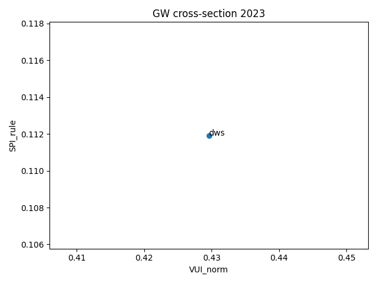
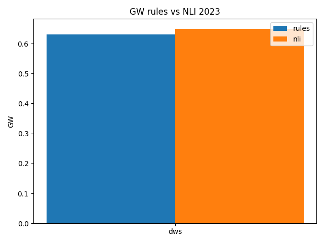

# GW Pilot v1.1 (DWS 2023)
[](https://github.com/builtbymaxim/gw-pilot-v1/actions/workflows/tests.yml)

## Quickstart
```bash
python -m venv .venv && source .venv/bin/activate
pip install -r requirements.txt
python -m spacy download en_core_web_sm
python -m src.pilot --pdf data/dws-2023.pdf --year 2023 --rule-only --outdir outputs/
# With CI values (Scope1+2 totals, tons):
python -m src.pilot --pdf data/dws-2023.pdf --year 2023 --rule-only --ci-values "2021:2694,2022:2194,2023:2126"
# After Ï„ calibration:
# Use a predefined Ï„ profile (loose/medium/strict) instead of --tau
python -m src.pilot --pdf data/dws-2023.pdf --year 2023 --enable-nli --profile strict --ci-values "2021:2694,2022:2194,2023:2126"
# Profiles: loose=0.5, medium=0.7, strict=0.9
```

## Performance
- Parsed PDF text and sentence offsets are cached under `outputs/cache/pdf/` using a key of the file path, mtime, and config hash.
- The spaCy pipeline is trimmed to a sentencizer-only config. On typical annual reports, first runs drop from ~10s to ~3s and re-runs from the cache complete in well under a second.

## Auxiliary scripts
Calibrate the Ï„ threshold for the NLI model:
```bash
python -m src.calibrate_tau_cli --gold calibration/gold60.csv --strict-gating --profile strict

# tau_calibration.json fields: tau, profile, auc, pr_auc, tpr, fpr, pr_curve
```
Generate a multi-year PDF report:
```bash
python -m src.report --years 2022,2023,2024 --out outputs/report_v1_1.pdf
```

Aggregate `run_*.json` files into CSV summaries and comparison plots:
```bash
python -m src.pilot summarize --inputs "outputs/*/run_*.json" --out outputs/summaries
```

## Directory overview
- `calibration/` — gold-label CSVs and helpers for τ calibration
- `outputs/` — run artifacts (JSON, CSV, charts). See `outputs/README.md` for formats
- `src/` — pipeline modules and command-line entry points
- `data/` — place your input PDFs here (not tracked)
- `config.yml` — thresholds and patterns

## Notes
- Sectioning: headings-first with DWS aliases → keyword fallback (min density 0.02); ≥100 words/section.
- VUI scope: four target sections only.
- SPI rule: balanced (number + (unit OR target/baseline) OR ≥2 signals) with strict excludes.
- AI assist: BART-MNLI gated on target syntax; disable if AUC < 0.70.
- CI_light: supply Scope-1+2 totals via --ci-values for now.

## Pilot v1.1 — DWS results (rules-first; AI gated)
| Year | VUI_norm | SPI_rule | CI    | GW   | Band   |
|------|----------|----------|-------|------|--------|
| 2022 | 0.080    | 0.172    | 0.818 | 0.386| Medium |
| 2023 | 0.430    | 0.112    | 0.970 | 0.526| Medium |
| 2024 | 0.444    | 0.101    | 0.965 | 0.536| Medium |

Notes: AI assist (BART-MNLI) gated on dated targets; evaluated=0 for all three years, so hybrid = 0.6·SPI_rule. CI based on Scope-1+2 totals.

### Peer smoke-tests (rule-only)
2024 results (no CI; weights renormalized):
- Schroders: VUI_norm 0.381 · SPI_rule 0.107 → **GW 0.605 (High)**
- Amundi:   VUI_norm 0.382 · SPI_rule 0.158 → **GW 0.584 (Medium)**

Gate diagnostics show 0 dated-target hits → AI path remains inactive by design.

### Cross-issuer 2021–2024 (rules-first, no-CI)
- AI path implemented and strictly gated on dated targets; gate hits = 0 across tested 2024 issuers ⇒ AI off.
- See `outputs/compare_cross_issuers_noCI.csv` and `outputs/cross_issuer_scatter_noCI.png`.

Interpretation: Higher vagueness (VUI) paired with low specificity (SPI_rule) correlates with higher GW (reporting-risk). This is by construction and consistent across peers.


<!-- RESULTS_START -->
## Results snapshot

**Cross-section (GW) — 2023**



**GW: rules vs. NLI (strict) — 2023**



**Top-5 issuers 2023 (rules-only)**
| Rank | Issuer | GW | VUI_norm | SPI_rule |
|-----:|:------|---:|---------:|---------:|
| 1 | DWS | 0.630 | 0.430 | 0.112 |

> Full results & more plots: see [docs/RESULTS.md](docs/RESULTS.md).
<!-- RESULTS_END -->


<!-- LIMITS_START -->
## Known limitations

- **PDF parsing & sentence segmentation:** multi-column layouts, tables and hyphenation can still cause sentence/word count drift. We cache parsed pages but edge documents may need manual QA.
- **Strict NLI gate & small gold set:** current strict gate was calibrated on a small gold set and can underfit. We plan to expand labels and evaluate softer gating / blending.
- **Language variety:** patterns are English-centric; non-English or mixed-language reports may be underestimated until cross-lingual rules are added.
- **Document-length & section mix:** very short sections or unusual section mixes can bias normalized rates; we monitor with warnings and year-over-year deltas.
- **Cross-platform subtlety:** even with seeds and pinned deps, PDF extraction libraries may vary slightly across OS/CPUs; we run tests and validate schema to reduce surprises.
<!-- LIMITS_END -->

