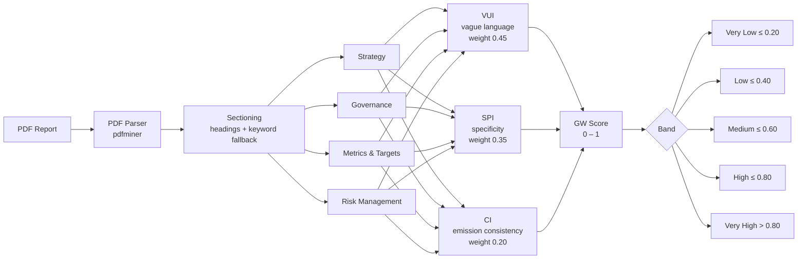

# Greenwashing Detection Pipeline

Automated NLP pipeline for detecting greenwashing signals in ESG and sustainability PDF reports. Scores each report on three dimensions — vague language (VUI), specificity (SPI), and emission consistency (CI) — and aggregates them into a GW score aligned with a 5-point human survey scale.

---

## Pipeline



---

## Scoring Components

| Component | What it measures | Weight | Direction |
|-----------|-----------------|--------|-----------|
| **VUI** — Vague/Uncertain Language Index | Hedge words and modal uncertainty per 1,000 words | 0.45 | Higher VUI → higher GW |
| **SPI** — Specific Performance Indicator | Fraction of sentences with precise numeric claims (units, targets, baselines) | 0.35 | Higher SPI → lower GW |
| **CI** — Consistency Index | Year-on-year emission reduction consistency (Scope 1+2) | 0.20 | Reductions → lower GW |

**SPI modes:**
- `--rule-only` — regex-based (fast, no model download)
- `--enable-nli` — blends rule-based (60%) with BART-MNLI semantic scoring (40%) for thesis-quality results

---

## GW Band Scale

| Band | GW Score | Survey equivalent | Interpretation |
|------|----------|-------------------|----------------|
| Very Low | ≤ 0.20 | 1 — Not at all | Highly specific, consistent, low hedging |
| Low | ≤ 0.40 | 2 — Slightly | Mostly specific with minor vagueness |
| Medium | ≤ 0.60 | 3 — Moderately | Mixed signals — some commitments, some vague language |
| High | ≤ 0.80 | 4 — Very | High vagueness or low specificity |
| Very High | > 0.80 | 5 — Extremely | Pervasive hedging, no measurable commitments |

---

## Quickstart

**Single PDF:**
```bash
python -m venv .venv && source .venv/bin/activate
pip install -r requirements.txt
python -m spacy download en_core_web_sm

# Rule-only (fast)
python -m src.pilot --pdf inputs/dws-2024.pdf --year 2024 --outdir outputs/

# With emission time-series for CI scoring
python -m src.pilot --pdf inputs/dws-2024.pdf --year 2024 \
  --ci-values "2022:2694,2023:2126,2024:1497" --outdir outputs/

# NLI-enhanced (requires torch + transformers)
python -m src.pilot --pdf inputs/dws-2024.pdf --year 2024 --enable-nli \
  --ci-values "2022:2694,2023:2126,2024:1497" --outdir outputs/
```

**Batch run (all 46 PDFs):**
```bash
jupyter lab scripts/run_all.ipynb
```
Set `ENABLE_NLI = False` for a fast pass or `True` for full NLI scoring.

---

## Batch Results — Rule-Only (46 reports, 12 companies, 2021–2024)

| Company | 2021 | 2022 | 2023 | 2024 | Avg Band |
|---------|------|------|------|------|----------|
| Amundi | 0.478 | 0.458 | 0.471 | 0.485 | medium |
| BlackRock | 0.418 | 0.388 | 0.393 | — | low–medium |
| Blackstone | 0.396 | 0.415 | 0.413 | 0.399 | medium |
| CITIC | 0.373 | 0.357 | 0.380 | 0.417 | low–medium |
| Credit Suisse | 0.458 | 0.464 | **0.653** | — | medium–high |
| DWS | 0.492 | 0.320 | 0.383 | 0.369 | low–medium |
| Impax | 0.472 | 0.485 | 0.472 | 0.450 | medium |
| KKR | 0.469 | 0.431 | 0.457 | 0.465 | medium |
| Schroders | 0.507 | 0.488 | 0.477 | 0.492 | medium |
| State Street | 0.507 | 0.499 | 0.477 | 0.467 | medium |
| Triodos | 0.448 | 0.468 | 0.500 | 0.406 | medium |
| UBS | 0.526 | 0.518 | 0.571 | 0.571 | medium |

> **Note:** Credit Suisse 2023 (GW = 0.653, *high*) is the UBS acquisition year — characterised by very low SPI (0.10) and elevated uncertainty language.

---

## File Structure

```
gw-pilot-v1/
├── src/
│   ├── pilot.py          # Main pipeline orchestrator (CLI entry point)
│   ├── parsing.py        # PDF text extraction (pdfminer) + sentence splitting
│   ├── sectioning.py     # Page → TCFD section assignment
│   ├── vui.py            # Vague language scoring
│   ├── spi.py            # Specificity scoring (rule-based)
│   ├── nli.py            # NLI semantic scoring (BART-MNLI)
│   ├── ci.py             # Emission consistency index
│   ├── gw.py             # GW score aggregation + banding
│   └── text_utils.py     # Shared utilities (normalize_year_tokens)
├── inputs/               # PDF reports (not tracked)
├── outputs/
│   ├── batch/            # Rule-only batch results (JSON per company/year)
│   └── batch_nli/        # NLI-enhanced batch results
├── scripts/
│   └── run_all.ipynb     # Batch runner + visualisation notebook
├── config.yml            # All thresholds, patterns, weights
└── requirements.txt
```

---

## Config Reference

| Parameter | Default | Description |
|-----------|---------|-------------|
| `weights.vui` | 0.45 | VUI weight in GW formula |
| `weights.r_spi` | 0.35 | SPI weight (as 1 − SPI) |
| `weights.r_ci` | 0.20 | CI weight (as 1 − CI) |
| `nli.tau` | 0.80 | Entailment threshold for NLI gate |
| `sectioning.min_density` | 0.02 | Min keyword density for fallback sectioning |
| `sectioning.min_words_per_section` | 100 | Min words to include a section |
| `spi.unit_patterns` | `%, tCO2e, kt, mt, ...` | Units that signal numeric specificity |
