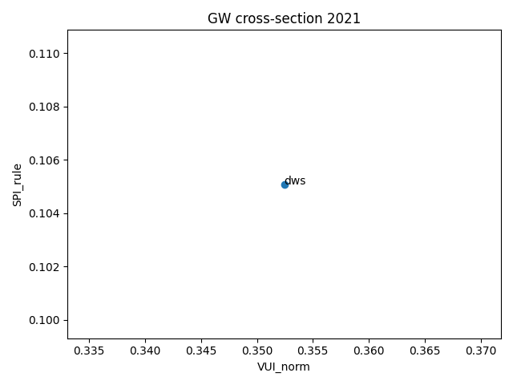
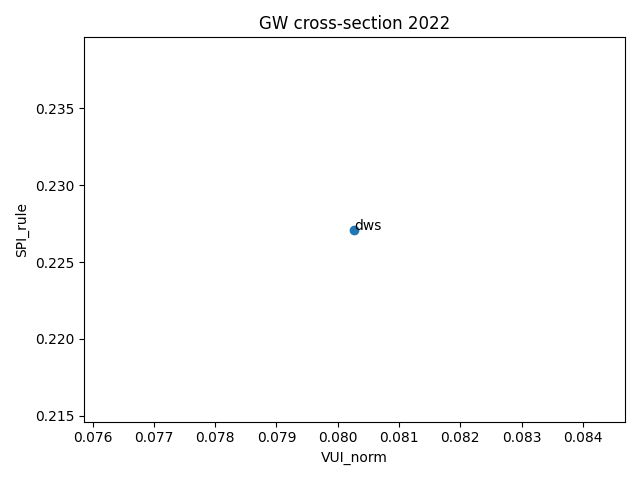
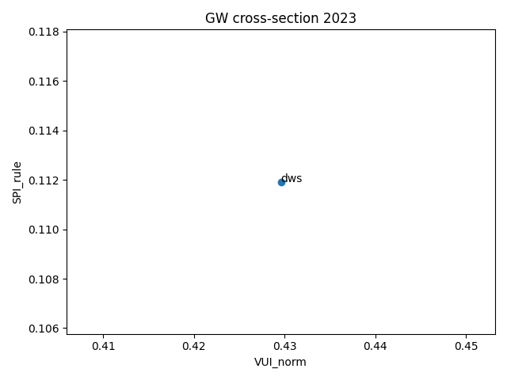
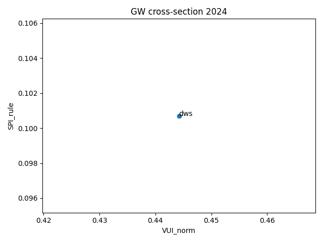
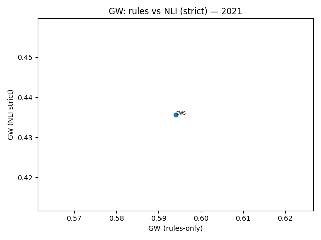
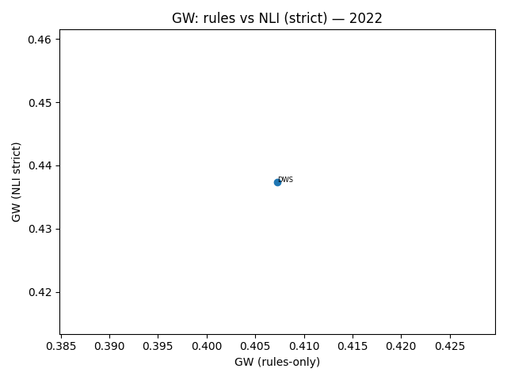
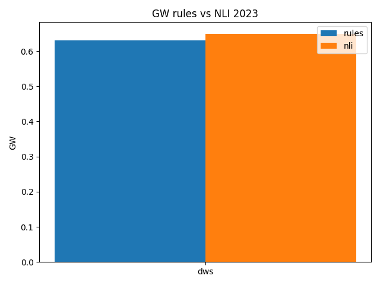
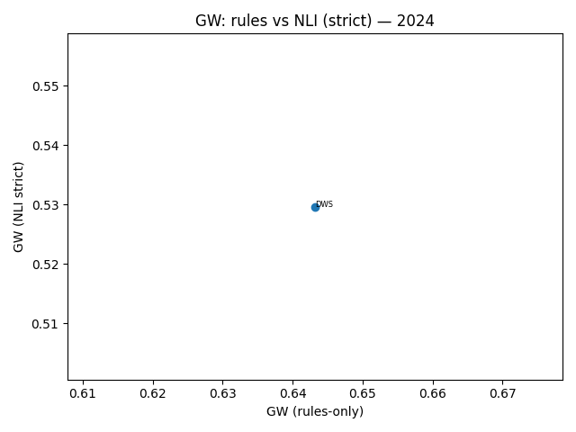

# Full results

This page collects the generated cross-sections, scatter plots and key CSVs.
All figures are reproducible from the repo (see README “Reproducibility”).

## Cross-sections (GW)
- 2021: 
- 2022: 
- 2023: 
- 2024: 

## Rules vs. NLI (strict)
- 2021: 
- 2022: 
- 2023: 
- 2024: 

## Key CSVs
- outputs/summaries/summary_rules_all.csv
- outputs/summaries/summary_2021_rules.csv, …, summary_2024_rules.csv
- outputs/summaries/compare_rules_vs_nli.csv
- outputs/summaries/compare_top10.csv, compare_bottom10.csv

> For large year-over-year shifts (ΔSPI, ΔVUI), also see
> outputs/summaries/warnings_applied.txt and meta.warnings in run JSONs.
