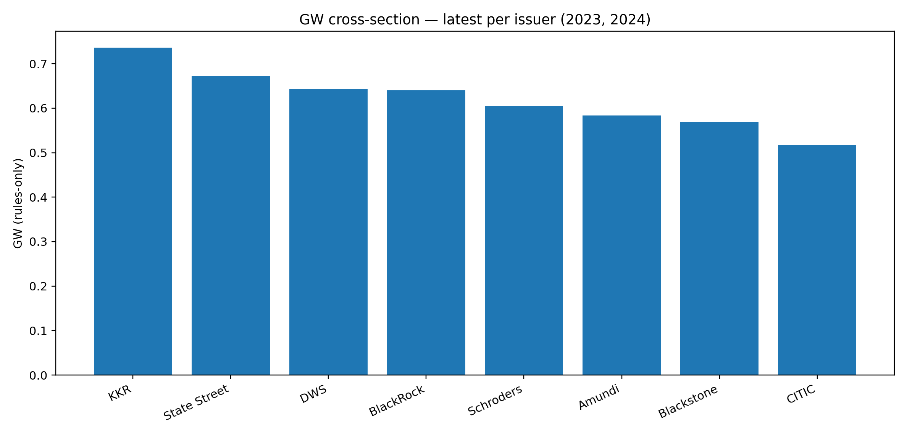
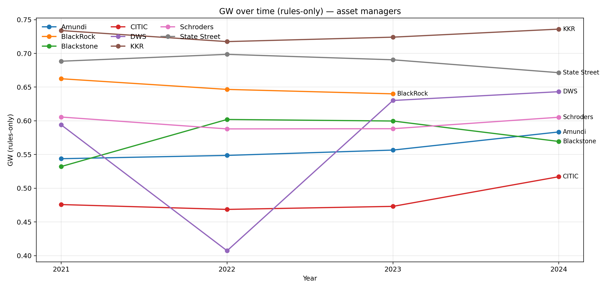

# Cross-Issuer Results (Rules-Only)

## Scope
- Asset managers: Amundi, BlackRock, Blackstone, CITIC, DWS, KKR, Schroders, State Street.
- Years: 2021–2024.
- Metrics: VUI_norm, SPI_rule, GW (rules-only).

## Headline Charts

## Tables
- Insert per-issuer/year table generated from `outputs/*_*_rules/run_*.json`.

## Notes
- Winsorization at p1/p99 applied to VUI_norm.
- Weights as in pilot v1.1; no CI blending.
